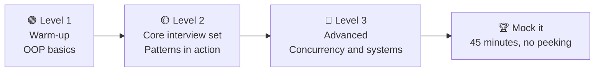

<p align="center">
  
</p>

<p align="center">
  <a href="https://github.com/Manu577228/50-LLD-Problems-Solved">
    
  </a>
</p>

<p align="center">
  <a href="https://github.com/Manu577228/50-LLD-Problems-Solved/stargazers"></a>
  <a href="https://github.com/Manu577228/50-LLD-Problems-Solved/network/members"></a>
  <a href="https://github.com/Manu577228/50-LLD-Problems-Solved/issues"></a>
  <a href="https://github.com/Manu577228/50-LLD-Problems-Solved/commits/main"></a>
  <a href="./LICENSE"></a>
</p>

<p align="center">
  
  
  
  
  
  <a href="https://youtube.com/@code-with-Bharadwaj"></a>
</p>

<h3 align="center">
  If this repo helps your prep, a ⭐ helps other engineers find it.
</h3>

---

## 🧭 Quick Navigation

| | | | |
|:--|:--|:--|:--|
| [🎯 What is this?](#-what-is-this) | [🗺️ Learning Roadmap](#️-learning-roadmap) | [🧩 Design Patterns Index](#-design-patterns-index) | [📂 Repo Structure](#-repo-structure) |
| [📚 All 50 Problems](#-all-50-problems) | [🗂️ Problems by Theme](#️-problems-by-theme) | [▶️ How to Use](#️-how-to-use-this-repo) | [🤝 Contributing](#-contributing) |
| [❓ FAQ](#-faq) | [📈 Star History](#-star-history) | [🧑‍💻 Author](#-author) | [⭐ Support](#-support-the-project) |

---

## 🎯 What is this?

**50 Low-Level Design (LLD) problems**, each solved in **both Java and Python**, with video walkthroughs on YouTube.

Low-level design rounds ask you to turn a vague prompt like *"Design a Parking Lot"* into clean classes, clear responsibilities, and extensible code. This repo gives you 50 worked examples so you can see how that is done, then practice it yourself.

<table align="center">
  <tr>
    <td align="center"><h1>50</h1><b>LLD Problems</b></td>
    <td align="center"><h1>2</h1><b>Languages<br/>Java + Python</b></td>
    <td align="center"><h1>100</h1><b>Implementations<br/>50 × 2</b></td>
    <td align="center"><h1>6</h1><b>Themes</b></td>
  </tr>
</table>

### What you get

| | |
|:--:|:--|
| 🧱 | **50 problems** from classic (Parking Lot, Elevator, ATM) to infrastructure (Rate Limiter, Circuit Breaker, Distributed Lock Manager) |
| ☕🐍 | **Every problem in Java and Python**, so you can study in the language of your interview |
| 🎥 | **Video explanations** for every problem on [Code With Bharadwaj](https://youtube.com/@code-with-Bharadwaj) |
| 🧩 | **Design patterns index** showing which patterns fit which problems |
| 🗺️ | **A roadmap** that tells you what to solve first, so you are never guessing where to start |

---

## 🗺️ Learning Roadmap

Do not solve all 50 in order. Follow the path that matches where you are.



### 🟢 Level 1: Warm-up (learn to model things)
`06` Parking Lot · `07` Vending Machine · `50` Tic-Tac-Toe · `09` ATM · `12` Library Management · `03` Logger

### 🟡 Level 2: Core interview set (patterns in action)
`11` Elevator · `10` Chess · `01` Rate Limiter · `17` In-Memory Cache · `18` Notification System · `27` Shopping Cart · `31` Coupon Manager · `42` Undo / Redo · `23` Authentication · `13` Calendar Scheduler

### 🔴 Level 3: Advanced (concurrency, reliability, extensibility)
`16` Distributed Lock Manager · `39` Circuit Breaker · `46` Job Queue Processor · `37` Distributed Counter · `44` Dependency Injection Container · `40` Workflow System · `22` Search Indexer · `47` Code Compiler Service

> 💡 **Tip:** Read the problem statement, close the repo, and try to sketch the classes yourself for 20 minutes. Then compare with the solution and the video. That gap is where the learning happens.

---

## 🧩 Design Patterns Index

Common patterns and the problems where they are a natural fit. Use this to practice one pattern across several problems.

| Pattern | Problems where it fits well |
|:--|:--|
| **State** | 07 Vending Machine · 08 Traffic Control · 09 ATM · 11 Elevator |
| **Strategy** | 01 Rate Limiter · 02 Load Balancer · 20 Payment Gateway · 31 Coupon Manager |
| **Observer** | 18 Notification System · 32 Auction · 38 Health Monitoring |
| **Command** | 14 Online Text Editor · 42 Undo / Redo |
| **Factory** | 18 Notification System · 20 Payment Gateway · 35 Shipping & Logistics |
| **Singleton** | 03 Logger · 49 Configuration Manager |
| **Chain of Responsibility** | 21 Form Validator · 23 Authentication System |
| **Proxy / Decorator** | 17 In-Memory Cache · 39 Circuit Breaker |

> This index shows where each pattern *commonly applies*. The exact patterns used in each solution are explained in the corresponding video.

---

## 📂 Repo Structure

<!-- UPDATE THIS BLOCK to match your real folder layout and names -->
```text
50-LLD-Problems-Solved/
├── Java/        # All 50 solutions in Java
├── Python/      # All 50 solutions in Python
├── README.md
└── LICENSE
```

---

## 📚 All 50 Problems

📄 *System Design Theory PDF: Credit → Interview Bit*

**Level key:** 🟢 Beginner · 🟡 Intermediate · 🔴 Advanced

| # | Problem | Core concepts | Level |
|:--:|:--|:--|:--:|
| 01 | Rate Limiter | Token bucket, sliding window, per-user limits | 🟡 |
| 02 | Load Balancer System | Round robin, weighted, health checks | 🟡 |
| 03 | Logger System | Log levels, appenders, singleton | 🟢 |
| 04 | URL Shortener (Bit.ly) | Encoding, key generation, collisions | 🟡 |
| 05 | Unique ID Generator | Snowflake-style IDs, clocks, uniqueness | 🟡 |
| 06 | Parking Lot System | Vehicle types, slots, pricing | 🟢 |
| 07 | Vending Machine | State machine, inventory, payments | 🟢 |
| 08 | Traffic Control System | State transitions, timers | 🟡 |
| 09 | ATM Machine | State machine, transactions, cash dispensing | 🟢 |
| 10 | Chess Game | Pieces, move validation, board state | 🟡 |
| 11 | Elevator System | Request scheduling, direction, state | 🟡 |
| 12 | Library Management System | Entities, lending rules, fines | 🟢 |
| 13 | Calendar / Booking Scheduler | Time intervals, conflict detection | 🟡 |
| 14 | Online Text Editor | Document model, commands, history | 🟡 |
| 15 | Restaurant Order Management | Orders, kitchen workflow, billing | 🟡 |
| 16 | Distributed Lock Manager (DLM) | Locks, expiry, ownership, concurrency | 🔴 |
| 17 | In-Memory Cache | Eviction policies (LRU, LFU), TTL | 🟡 |
| 18 | Generic Notification System | Channels, templates, extensibility | 🟡 |
| 19 | File Upload Utility | Chunking, validation, progress | 🟡 |
| 20 | Payment Gateway Integration | Adapters, providers, retries | 🟡 |
| 21 | Form Validator | Rules, composition, error reporting | 🟢 |
| 22 | Search Indexer | Inverted index, tokenization | 🔴 |
| 23 | Authentication System | Credentials, sessions, tokens | 🟡 |
| 24 | Permission & Role Management | RBAC, role hierarchy | 🟡 |
| 25 | Multi-Factor Authentication | OTP, verification flow, expiry | 🟡 |
| 26 | Password Vault System | Encryption boundaries, secure storage | 🟡 |
| 27 | E-Commerce Shopping Cart | Cart, pricing, checkout | 🟡 |
| 28 | Product Review System | Ratings, aggregation, moderation | 🟢 |
| 29 | Movie / Video Streaming System | Catalog, playback, recommendations | 🟡 |
| 30 | Booking / Reservation System | Availability, double-booking prevention | 🟡 |
| 31 | Coupon / Discount Manager | Rule engine, stacking, validity | 🟡 |
| 32 | Auction System | Bidding, winner selection, notifications | 🟡 |
| 33 | Inventory Management System | Stock, reservations, thresholds | 🟡 |
| 34 | Loyalty Program | Points, tiers, redemption | 🟢 |
| 35 | Shipping & Logistics System | Shipments, carriers, tracking | 🟡 |
| 36 | Subscription Manager | Plans, billing cycles, renewals | 🟡 |
| 37 | Distributed Counter | Sharded counters, consistency | 🔴 |
| 38 | Health Monitoring System | Heartbeats, thresholds, alerts | 🟡 |
| 39 | Circuit Breaker | Open / half-open / closed, failure thresholds | 🔴 |
| 40 | Workflow System | Steps, dependencies, execution order | 🔴 |
| 41 | Bulk Data Importer | Batching, validation, error handling | 🟡 |
| 42 | Undo / Redo Functionality | Command history, stacks | 🟡 |
| 43 | Search Suggestion / Autocomplete | Trie, ranking | 🟡 |
| 44 | Dependency Injection Container | Registration, resolution, lifecycles | 🔴 |
| 45 | Geo-Location Service | Coordinates, distance, nearby search | 🟡 |
| 46 | Job Queue Processor | Workers, retries, concurrency | 🔴 |
| 47 | Code Compiler Service | Pipeline stages, sandboxing | 🔴 |
| 48 | Dynamic Feature Flag Manager | Rules, rollout, evaluation | 🟡 |
| 49 | Configuration Manager | Layered config, reload, singleton | 🟢 |
| 50 | Tic-Tac-Toe Game | Board, turns, win detection | 🟢 |

> **Want per-problem links?** Each row will link to its Java folder, Python folder, and YouTube video as they are added. See [Contributing](#-contributing).

---

## 🗂️ Problems by Theme

<details>
<summary><b>🧱 Core Building Blocks</b> (5)</summary>

`01` Rate Limiter · `02` Load Balancer · `03` Logger · `04` URL Shortener · `05` Unique ID Generator

</details>

<details>
<summary><b>🎮 Real-World Machines & Games</b> (7)</summary>

`06` Parking Lot · `07` Vending Machine · `08` Traffic Control · `09` ATM · `10` Chess · `11` Elevator · `50` Tic-Tac-Toe

</details>

<details>
<summary><b>📚 Management & Productivity</b> (4)</summary>

`12` Library Management · `13` Calendar Scheduler · `14` Online Text Editor · `15` Restaurant Order Management

</details>

<details>
<summary><b>🌐 Distributed Systems & Reliability</b> (6)</summary>

`16` Distributed Lock Manager · `17` In-Memory Cache · `37` Distributed Counter · `38` Health Monitoring · `39` Circuit Breaker · `46` Job Queue Processor

</details>

<details>
<summary><b>🔐 Security & Access</b> (4)</summary>

`23` Authentication · `24` Permission & Roles · `25` Multi-Factor Authentication · `26` Password Vault

</details>

<details>
<summary><b>🛒 Commerce & Business</b> (10)</summary>

`27` Shopping Cart · `28` Product Reviews · `29` Video Streaming · `30` Booking / Reservation · `31` Coupon Manager · `32` Auction · `33` Inventory · `34` Loyalty Program · `35` Shipping & Logistics · `36` Subscription Manager

</details>

<details>
<summary><b>🧰 Platform Services & Developer Tooling</b> (14)</summary>

`18` Notification System · `19` File Upload · `20` Payment Gateway · `21` Form Validator · `22` Search Indexer · `40` Workflow System · `41` Bulk Data Importer · `42` Undo / Redo · `43` Autocomplete · `44` DI Container · `45` Geo-Location · `47` Code Compiler Service · `48` Feature Flag Manager · `49` Configuration Manager

</details>

---

## ▶️ How to Use This Repo

1. **Pick a problem** from the [roadmap](#️-learning-roadmap) based on your level.
2. **Attempt it first.** Spend 20 to 30 minutes listing requirements, entities, and relationships. Sketch a class diagram on paper.
3. **Watch the video** on [Code With Bharadwaj](https://youtube.com/@code-with-Bharadwaj) and compare it with your design.
4. **Read the code** in Java or Python. Focus on *why* classes are split the way they are.
5. **Extend it.** Add a new requirement (a new vehicle type, a new payment method) and see how easily the design absorbs it. If it is painful, the design has a flaw worth understanding.
6. **Re-solve it in a mock interview** a week later, without looking.

### A simple framework for any LLD interview

| Step | What to do |
|:--:|:--|
| 1 | Clarify requirements and scope |
| 2 | Identify entities and their relationships |
| 3 | Define interfaces and responsibilities (apply SOLID) |
| 4 | Choose patterns only where they earn their place |
| 5 | Write the core flow in code |
| 6 | Discuss extensibility, concurrency, and edge cases |

---

## 🤝 Contributing

Contributions are welcome, and small ones count. Good first contributions:

- 🔗 Add the YouTube or folder link for a problem in the table above
- 🧪 Add unit tests for any solution
- 🌐 Add a solution in another language (C++, Go, TypeScript, C#)
- 📝 Add a UML or class diagram for a problem
- 🐛 Fix a bug or improve naming and comments
- 💡 Suggest a new problem by opening an issue

**Steps:** fork the repo → create a branch → make your change → open a pull request describing what you changed and why.

Look for issues labelled **`good first issue`** and **`help wanted`**.

---

## ❓ FAQ

<details>
<summary><b>Is this enough to crack an LLD round?</b></summary>

It gives you a strong set of worked examples across the problem types that come up most. Real preparation also means practising on your own: attempt each problem before reading the solution, and do timed mock rounds.

</details>

<details>
<summary><b>Do I need to know design patterns first?</b></summary>

No. Start with the Level 1 problems, then use the [Design Patterns Index](#-design-patterns-index) to learn patterns through the problems that need them.

</details>

<details>
<summary><b>Java or Python: which should I read?</b></summary>

Whichever you will use in the interview. If you know both, comparing the two versions is a good way to see which design choices are language-specific and which are universal.

</details>

<details>
<summary><b>Can I use this code in my own projects or videos?</b></summary>

Yes, under the terms of the [MIT License](./LICENSE). Credit is appreciated.

</details>

<details>
<summary><b>Where are the video explanations?</b></summary>

On the [Code With Bharadwaj](https://youtube.com/@code-with-Bharadwaj) YouTube channel.

</details>

---

## 📈 Star History

<a href="https://star-history.com/#Manu577228/50-LLD-Problems-Solved&Date">
  <picture>
    <source media="(prefers-color-scheme: dark)" srcset="https://api.star-history.com/svg?repos=Manu577228/50-LLD-Problems-Solved&type=Date&theme=dark" />
    <source media="(prefers-color-scheme: light)" srcset="https://api.star-history.com/svg?repos=Manu577228/50-LLD-Problems-Solved&type=Date" />
    
  </picture>
</a>

---

## ⭐ Support the Project

| | |
|:--:|:--|
| ⭐ | **Star** this repo so other engineers can find it |
| 🔄 | **Fork** it and build your own versions |
| 🎥 | **Subscribe** to [youtube.com/@code-with-Bharadwaj](https://youtube.com/@code-with-Bharadwaj) for the video walkthroughs |
| 💬 | **Share** it with a friend who is preparing for interviews |

---

## 🔗 More from the Same Series

| Repo | What it covers |
|:--|:--|
| [Important HLD Problems](https://github.com/Manu577228/Important-HLD-Problems) | 10 high-level system design problems |
| [CP Core Algorithms 150](https://github.com/Manu577228/CP-Core-Algorithms-150) | 150 advanced competitive programming algorithms |

**Interview prep series: LLD → HLD → CP.**

---

## 🧑‍💻 Author

<p align="center">
  
</p>

<p align="center">
  <b>Bharadwaj</b><br/>
  Software Engineer · LeetCode Best Global Rank 41 · YouTube educator
</p>

<p align="center">
  <a href="https://github.com/Manu577228">
    
  </a>
  &nbsp;
  <a href="https://youtube.com/@code-with-Bharadwaj">
    
  </a>
</p>

---

<p align="center">
  <b>Learn the design, not just the code. If this repo helped, give it a ⭐</b>
</p>

<p align="center">
  
</p>
